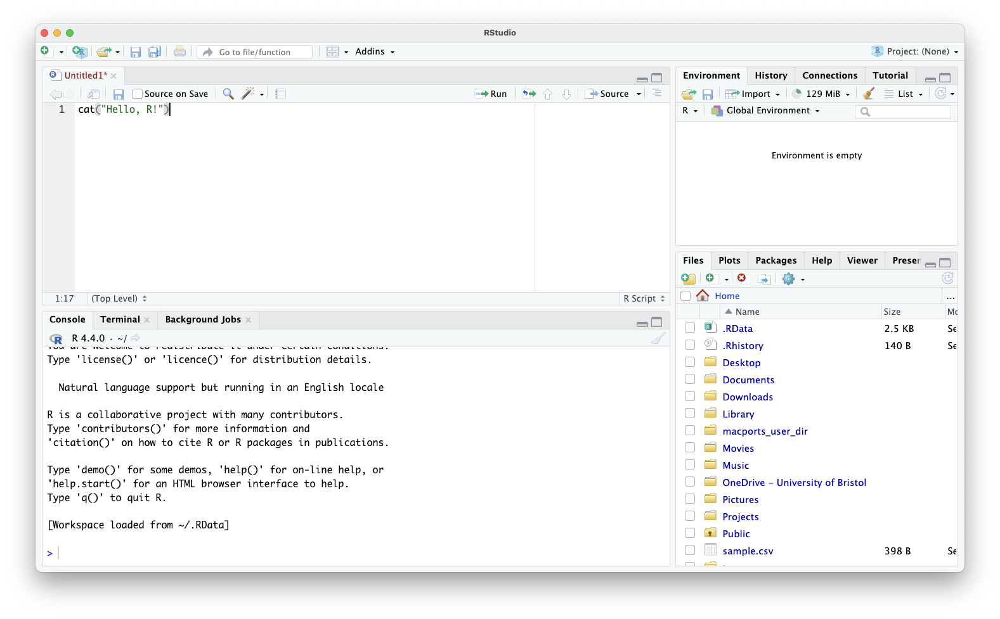
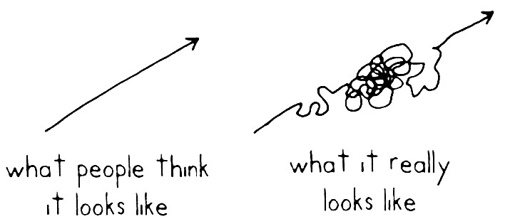

{width=220px fig-alt="University of Bristol logo"}

<!-- Course website hub: only rendered for the GitHub Pages build (render.R sets site: true) -->
::: {.content-visible when-meta="site"}
## About this page {.unnumbered .unlisted}

Everything you need for the course is on this page. The slides we use during the session are just below, followed by links to further material, and then the full course notes with every exercise and answer. Bookmark this page so you can come back to it after the course.

::: {.slides-embed}
```{=html}
<iframe id="slides-frame" src="slides.html" title="Course slides" allowfullscreen></iframe>
```
:::

::: {.hub-buttons}
```{=html}
<button type="button" class="btn hub-btn" onclick="document.getElementById('slides-frame').requestFullscreen()">⛶ Full screen</button>
<a class="btn hub-btn" href="slides.html" target="_blank" rel="noopener">Open slides in a new tab</a>
```
:::

Click on the slides, then use the arrow keys to move through them.

### Course materials {.unnumbered .unlisted}

::: {.cards .hub-cards}
::: {.card}
**[Instructor version](instructor.html)**<br>
These notes plus the delivery team's guidance: timings, live-coding cues and common pitfalls.
:::

::: {.card}
**[Intro to R (Part 1)](https://bristol-training.github.io/intro-r-1/)**<br>
The full-length JGI course.
:::

::: {.card}
**[Intro to R (Part 2)](https://bristol-training.github.io/intro-r-2/)**<br>
The full-length JGI course.
:::

::: {.card}
**[Introduction to Data Analysis in R](https://bristol-training.github.io/intro-data-analysis-r/)**<br>
The full-length JGI course.
:::
:::
:::

# Introduction {.unnumbered}

Welcome to this course on R programming and data analysis! This course combines the Jean Golding Institute's *Intro to R (Part 1)*, *Intro to R (Part 2)* and *Introduction to Data Analysis in R* into a single journey. It starts with your very first line of R and ends with fitting statistical models and a first taste of machine learning.

R is a popular *programming language* among researchers, data scientists and statisticians across many fields, thanks to its statistical power, visualisation capabilities and extensive package ecosystem. A programming language is a formal system of instructions that lets humans tell a computer what to do. This course shows you how to give those instructions, starting with simple tasks and building up to a complete data analysis.

Throughout the course we will work with data about penguins: the [Palmer Archipelago penguins](https://allisonhorst.github.io/palmerpenguins/) collected by Dr. Kristen Gorman at Palmer Station, Antarctica. The dataset records the species, island, bill size, flipper length, body mass and sex of 344 penguins. It is small enough to understand at a glance but rich enough to do real analysis with.

::: {.big-statement}
344 penguins. One course. Let's find out what makes them different.
:::

Each section starts with a question about the penguins, and teaches you the R you need to answer it. Here's the journey:

::: {.flow}
[Hello R]{.step} [→]{.arrow} [Variables]{.step} [→]{.arrow} [Data structures]{.step} [→]{.arrow} [Control flow]{.step} [→]{.arrow} [Packages]{.step} [→]{.arrow} [Functions]{.step}
:::

::: {.flow}
[Reading data]{.step} [→]{.arrow} [Pipes]{.step} [→]{.arrow} [Tidy data]{.step} [→]{.arrow} [Summaries]{.step} [→]{.arrow} [Plots]{.step} [→]{.arrow} [Models & ML]{.step}
:::

The first half teaches you to *program*; the second half teaches you to *analyse data*.

### How to get the most out of this course {.unnumbered}

- **Type the code yourself** in your own script, rather than copying and pasting. Your fingers learn as much as your brain.
- **Errors are normal.** Everyone gets them, all the time. Read them carefully: they usually tell you exactly what's wrong.
- **Experiment.** Change a number, swap a column, break something on purpose and see what happens.

### Intended learning outcomes {.unnumbered}

By the end of this course, you will:

- Understand what a programming language is and how to run R code in RStudio.
- Be able to create, save and run R scripts.
- Know R's basic data types and data structures (vectors, lists, matrices and data frames).
- Be able to control the flow of a program with `if`, `for` and `while`.
- Feel confident finding, installing and loading packages.
- Know how to write your own functions, including handling errors.
- Be familiar with the `tidyverse` ecosystem, and able to read, filter, tidy, summarise and transform data.
- Be able to visualise data with `ggplot2`.
- Be able to fit and interpret simple statistical models, and try some basic machine learning.

## How to read this document {.unnumbered}

In this documentation, any time that we are seeing a small snippet of R code, we'll see it written in a grey box like the following:

```{.r}
cat("Hello, R")
```

If the commands are executed by the machine we will see the output of them below, marked with a vertical purple line:

```{r}
cat("Hello, R!")
```

By contrast, you will see larger pieces of code as scripts with a given name, e.g. `script.R`, in a code block with a darker header:

```{.r filename="script.R"}
name <- "Jean Golding"
cat("Hello,", name, "!")
```

We may ask you to run a script using the `Command Prompt` (Windows) or `Terminal` (Mac and Linux). We will show you what commands to run and they will look like this:

```{.bash filename="Terminal/Command Prompt"}
Rscript script.R
```

In some cases we will introduce general programming concepts and structures using pseudocode, a high-level, easy-to-read syntax close to natural language. This should not be confused with R code and cannot be executed on your machine, but it is useful to describe how your code should behave. Here is an example:

```
FOR EACH penguin IN my_study
    IF (penguin body mass > 4000 g)
        DO SOMETHING
    OTHERWISE
        DO SOMETHING ELSE
```

At the end of each section there is an exercise, and it is important you try to answer it yourself to understand how R works. Exercises are shown in blue boxes followed by a yellow box that contains the answer. We recommend you try each exercise yourself before looking at the solution.

::: {#exampleN .callout-note icon=false title='Exercise'}
This is an exercise. You will need to click in the below box to see the answer.
:::

::: {#answerN .callout-caution icon=false title='Answer (click to open)' collapse="true"}
This is the answer.
:::

Last, we will highlight important points using green boxes like this one:

::: {#keypointsN .callout-tip icon=false title='Key points'}
These are important concepts and technical notes.
:::

::: {.content-hidden when-meta="attendee"}
::: {.callout-important icon=false title='Instructor notes'}
Red boxes like this one are **instructor notes**. They are removed from the attendee copy of these notes (see `README.md`).

**Delivery model:** we do not walk through these notes on screen. Instead, live-code in RStudio while attendees follow along in their own scripts. Use the accompanying slides (`r-course-slides.html`) to introduce each section, then switch to RStudio. The code chunks in each section are the script to build. Type them, don't paste them, and narrate as you go.

**Suggested timings (full day, ~6 hours of teaching):**

| Sections | Topic | Approx. time |
|---|---|---|
| 1–2 | Hello R, variables & operators | 40 min |
| 3 | Data structures | 30 min |
| 4 | Control flow | 40 min |
| 5–6 | Packages & functions | 50 min |
| 7–8 | Reading data, tibbles & pipes | 50 min |
| 9–10 | Tidy data & analysis | 40 min |
| 11 | Plotting | 40 min |
| 12 | Modelling & ML | 50 min |

For a two-day delivery, split after section 6. Leave ~10 minutes per section for the end-of-section exercise.
:::
:::

## Workspace setup {.unnumbered}

**Please follow our [installation instructions](https://bristol-training.github.io/data-science-project-setup/)** to install R and RStudio.

Once you've gone through those, you should be ready to get started!

::: {.content-hidden when-meta="attendee"}
::: {.callout-important icon=false title='Instructor notes'}
Ask attendees to install the course packages *before* the session if possible, as installing the `tidyverse` on a slow connection can take several minutes:

```{.r}
install.packages(c("tidyverse", "palmerpenguins", "lme4", "rpart"))
```

Start the session by creating a new RStudio Project (*File → New Project → New Directory*) so everyone has a clean working directory.
:::
:::

# Hello, R!

[How do I tell a computer what to do?]{.lead-question}

R is a scripting language, meaning that commands are interpreted at runtime rather than translated into machine code (compiled) beforehand. The simplest way to run a command in R is to use the R command line. Follow these steps:

- Open a Command Prompt (Windows) or Terminal (MacOS or Linux) on your computer. Alternatively, you can try this on the *Terminal* tab in RStudio.
- Type `R` and press *Enter* to start the R interpreter. You should see the R prompt (`>`).

```{.bash filename="Terminal/Command Prompt"}
R
```

```{r filename="Terminal/Command Prompt"}
#| echo: false
cat(
  "R version 4.5.2 (2025-10-31) -- \"[Not] Part in a Rumble\"
Copyright (C) 2025 The R Foundation for Statistical Computing

R is free software and comes with ABSOLUTELY NO WARRANTY.
You are welcome to redistribute it under certain conditions.
Type 'license()' or 'licence()' for distribution details.

Type 'demo()' for some demos, 'help()' for on-line help, or
'help.start()' for an HTML browser interface to help.
Type 'q()' to quit R.

> "
)
```

- At the prompt, type a simple R command like `print("Hello, R!")` or `cat("Hello, R!")`. Press *Enter* to execute the command. You should see "Hello, R!" printed on the screen.

```{r}
cat("Hello, R!")
```

**You can do the same directly in the *Console* tab in RStudio**. In fact, RStudio has already done the step of opening R for us.

{fig-alt="Screenshot of the RStudio window showing the editor, console, environment and files panes"}

To exit the R interpreter, type `q()`. Note that if you do this in RStudio you will close the R session.

## Scripts

There are two ways to give R instructions:

::: {.cards}
::: {.card}
**The console is like a calculator**
Type a command, get an answer straight away. But nothing is saved: close R and it's gone.
:::
::: {.card}
**A script is like a recipe**
A file of steps you can save, re-run any time and share with others.
:::
:::

An R script is a simple text file containing a set of instructions. Scripts allow us to save instructions so that we can automate repetitive tasks and re-run our analysis without retyping it. R will read your script starting at the top and run each line of code until it reaches the bottom.

You can write scripts in any text editor, but here we are going to use **RStudio**. Go to *File → New File → R Script* and type into the editor panel:

```{r filename="hello.R"}
cat("Hello, R!")
```

Then go to *File → Save* and call it `hello.R`. R files end in the extension `.R`. In the *Files* panel you should now be able to see `hello.R`.

To run the code, click the *Run* button at the top right of the editor (or press *Ctrl+Enter* / *Cmd+Enter*). This runs the current line, or the selected lines, in the console. To run the whole script, click *Source*.

Alternatively, we can use the Terminal to run a script with the `Rscript` command, followed by the name of the script:

```{.bash filename="Terminal/Command Prompt"}
Rscript hello.R
```

Congratulations, you've just written and executed your very first R script!

## `print` and `cat`

R has two common ways of showing output. `print()` displays an object as R sees it (including quotes and an index like `[1]`), while `cat()` *concatenates* its arguments and prints them as plain text, separated by spaces:

```{r}
print("Hello, penguins!")
cat("Hello,", "penguins!")
```

## Commenting your script

It is **good practice** to add comments to your code so it is easy to understand by other people, or by yourself in a few months' time. Anything after a `#` symbol is ignored by R:

```{r filename="penguin.R"}
# This script describes my favourite penguin
favourite <- "Gentoo"

# cat("Don't print me!")

cat("My favourite penguin is the", favourite) # print my favourite penguin
```

::: {#keypoints1 .callout-tip icon=false title='Key points'}
- Always give your R scripts a `.R` extension.
- In RStudio, you *write* code in the editor and *run* it in the console.
- Use `#` to write comments explaining *why* your code does what it does.
:::

::: {.content-hidden when-meta="attendee"}
::: {.callout-important icon=false title='Instructor notes'}
**Live code:** type `cat("Hello, R!")` in the console first, then create `hello.R` and run it with *Run*, *Source* and `Rscript` from the Terminal tab. Show the difference between `print` and `cat`.

**Pitfalls:** Windows users may find `Rscript` isn't on their PATH. Don't get stuck here; RStudio's *Source* button is enough. Encourage everyone to keep one script open all day and add to it, rather than typing in the console.
:::
:::

::: {#exercise1 .callout-note icon=false title='Exercise'}
Create a script called `hello_penguins.R` that:

1. starts with a comment describing what the script does,
2. stores the name of a penguin species in a variable,
3. prints a greeting such as `Hello, Adelie penguins!` using `cat`.

Run it from RStudio, and then (if you can) from the Terminal using `Rscript`.
:::

::: {#answer1 .callout-caution icon=false title='Answer' collapse="true"}
```{r filename="hello_penguins.R"}
# Greet a species of penguin
species <- "Adelie"

cat("Hello,", species, "penguins!")
```

```{.bash filename="Terminal/Command Prompt"}
Rscript hello_penguins.R
```
:::

# Variables, data types and operators

[How do I make R remember things?]{.lead-question}

## Variables

A variable is a symbolic name that refers to an object. Variables act as containers for storing data values and are created when you assign a value to them using the assignment operator `<-`. For example, here we describe a single penguin:

```{r}
species <- "Adelie"
bill_length_mm <- 39.1
flipper_length_mm <- 181L
is_female <- FALSE
```

Think of a variable as a **labelled box**. `<-` puts a value in the box, and you can read it as "**gets**": *`bill_length_mm` gets 39.1*.

::: {.flow}
[bill_length_mm]{.step .light} [←]{.arrow} [39.1]{.step}
:::

Whenever you use the name, R looks inside the box. In RStudio, the *Environment* pane shows all your boxes and what's in them.

The value stored in a variable can change throughout your program, and can be any data type such as numbers, text or `TRUE`/`FALSE` values.

::: {#keypoints2 .callout-tip icon=false title='Assignment operators'}
In R, both `=` and `<-` can be used to assign values, but they have subtle differences in usage.

- `<-` is the traditional and preferred assignment operator in R:
    ```{.r}
    x <- 5
    ```
- `=` is most commonly used to name the arguments of a function:
    ```{.r}
    mean(x = c(1, 2, 3))
    ```

In RStudio, *Alt + -* (Windows) or *Option + -* (Mac) types `<-` for you.
:::

Choosing a good name for a variable is important. A non-descriptive name (or worse, an incorrect one) will confuse you and anyone reading your code. For a variable holding a bill length in millimetres, avoid names like `bl` or `x` and instead use a name like `bill_length_mm`. Remember, code will be written once but read many times, so make it easy to read.

::: {#keypoints3 .callout-tip icon=false title='Variable names'}
- Variable names can include letters, digits, periods (`.`) and underscores (`_`), but cannot start with a digit or underscore. `bill_length` and `penguin_2` are valid; `2penguin` and `bill-length` are **not**.
- Variable names are case-sensitive: `Species`, `species` and `SPECIES` are three different variables.
:::

## Basic data types

R has several built-in basic data types. The most common are numbers, text (characters) and booleans (logicals).

There are four you will meet every day:

::: {.cards}
::: {.card}
**numeric**
`39.1`
:::
::: {.card}
**integer**
`181L`
:::
::: {.card}
**character**
`"Adelie"`
:::
::: {.card}
**logical**
`TRUE` / `FALSE`
:::
:::

In full:

Description                       | Type       | Example
----------------------------------|------------|----------------
floating-point numbers            | numeric    | `bill_length_mm <- 39.1`
integers or whole numbers         | integer    | `flipper_length_mm <- 181L`
textual data (strings)            | character  | `species <- "Adelie"`
boolean values (true or false)    | logical    | `is_female <- FALSE`
complex numbers                   | complex    | `z <- 2i + 7`

You can check the type of any variable with the `class()` function:

```{r}
cat("species:", species, "-", class(species), "\n")
cat("bill_length_mm:", bill_length_mm, "-", class(bill_length_mm), "\n")
cat(
  "flipper_length_mm:",
  flipper_length_mm,
  "-",
  class(flipper_length_mm),
  "\n"
)
cat("is_female:", is_female, "-", class(is_female), "\n")
```

Note the `L` after `181`: this tells R that we want an integer. Without it, R stores all numbers as numeric (floating-point) values. The `"\n"` at the end of `cat` starts a new line.

You can convert between types using functions such as `as.integer()`, `as.numeric()` and `as.character()`:

```{r}
body_mass <- "3750"
class(body_mass)

body_mass <- as.numeric(body_mass)
class(body_mass)
```

::: {#keypoints4 .callout-tip icon=false title="Note that"}
It's important that when writing numbers in your scripts you do not put quotation marks around them, otherwise R will treat them as strings. `3750` is a number, but `"3750"` is just a string of characters, and you cannot do arithmetic with it.
:::

## Operators

Operators let us perform operations on variables and values, such as multiplying two numbers or checking which one is bigger.

### Arithmetic operators

Description                 | Operator | Example
----------------------------|----------|----------------
Addition                    | `+`      | `a + b`
Subtraction                 | `-`      | `a - b`
Multiplication              | `*`      | `a * b`
Division                    | `/`      | `a / b`
Integer (floor) division    | `%/%`    | `a %/% b`
Modulo (remainder)          | `%%`     | `a %% b`
Exponentiation              | `^`      | `a ^ b`

```{r}
body_mass_g <- 3750

cat("Body mass in kg:", body_mass_g / 1000, "\n")
cat("Whole kilograms:", body_mass_g %/% 1000, "\n")
cat("Grams left over:", body_mass_g %% 1000, "\n")
```

### Comparison operators

We can compare two values using comparison operators. The result is always a logical, `TRUE` or `FALSE`.

Description                 | Operator | Example
----------------------------|----------|----------------
Equal to                    | `==`     | `a == b`
Not equal to                | `!=`     | `a != b`
Greater than                | `>`      | `a > b`
Less than                   | `<`      | `a < b`
Greater than or equal to    | `>=`     | `a >= b`
Less than or equal to       | `<=`     | `a <= b`

```{r}
cat("Is it an Adelie?", species == "Adelie", "\n")
cat("Is it heavier than 4 kg?", body_mass_g > 4000, "\n")
```

### Logical operators

Logical operators combine or negate logical values.

Description                 | Operator  | Example
----------------------------|-----------|----------------
Logical AND (element-wise)  | `&`       | `(a == b) & (a > c)`
Logical AND (single value)  | `&&`      | `(a == b) && (a > c)`
Logical OR (element-wise)   | `\|`      | `(a > b) \| (a < c)`
Logical OR (single value)   | `\|\|`    | `(a > b) \|\| (a < c)`
Logical NOT                 | `!`       | `!(a > b)`

```{r}
cat(
  "Adelie AND heavier than 4 kg?",
  species == "Adelie" & body_mass_g > 4000,
  "\n"
)
cat(
  "Adelie OR heavier than 4 kg?",
  species == "Adelie" | body_mass_g > 4000,
  "\n"
)
cat("NOT female?", !is_female, "\n")
```

::: {.callout-warning icon=false title='Spot the mistake'}
::: {.bad}
`species = "Gentoo"`: this **assigns** "Gentoo" to `species`
:::

::: {.good}
`species == "Gentoo"`: this **asks** whether `species` is equal to "Gentoo"
:::

And numbers in quotes are text, so you can't do maths with them:

```{r}
#| purl: false
"3750" + 1
```

The error message is R's way of saying "you can't add text to a number".
:::

::: {#keypoints5 .callout-tip icon=false title='Key points'}
- R is dynamically typed: you don't need to declare the type of a variable.
- Use `class()` to check a type, and `as.numeric()`, `as.integer()`, `as.character()` etc. to convert.
- Comparisons and logical operators always return `TRUE` or `FALSE`.
- `=` assigns, `==` compares. Mixing them up is one of the most common mistakes!
:::

::: {.content-hidden when-meta="attendee"}
::: {.callout-important icon=false title='Instructor notes'}
**Live code:** describe one penguin with four variables, run `class()` on each, then show arithmetic, comparison and logical operators on them. Show the *Environment* pane updating as you create variables.

**Pitfalls:** `"3750" + 1` gives an error. Show it deliberately and read the error message aloud. Also show that strings compare alphabetically (`"Adelie" < "Gentoo"`).
:::
:::

::: {#exercise2 .callout-note icon=false title='Exercise'}
A Gentoo penguin has a bill that is 47.5 mm long and 15.0 mm deep, and it weighs 5200 g.

1. Store these values in well-named variables.
2. Without using R, what type is each variable? Check with `class()`.
3. Calculate the ratio of bill length to bill depth.
4. Print `TRUE` or `FALSE` for whether the penguin is a Gentoo **and** weighs more than 5 kg.
:::

::: {#answer2 .callout-caution icon=false title='Answer' collapse="true"}
```{r}
species <- "Gentoo"
bill_length_mm <- 47.5
bill_depth_mm <- 15.0
body_mass_g <- 5200

class(species)
class(bill_length_mm)
class(body_mass_g)

bill_ratio <- bill_length_mm / bill_depth_mm
cat("Bill length:depth ratio:", bill_ratio, "\n")

cat("Heavy Gentoo?", species == "Gentoo" & body_mass_g > 5000, "\n")
```

`species` is a character; the other three are numeric. `5200` is numeric rather than integer because we didn't write `5200L`.
:::

# Data structures

[How do I store more than one thing?]{.lead-question}

Until now all our variables have held a single value. It's very common to want to refer to collections of data, for example the body masses of every penguin in a study. R has several built-in data structures for this. Here we cover four of the most used:

::: {.cards}
::: {.card}
**vector**
One row of the **same** type
:::
::: {.card}
**matrix**
A grid of the **same** type
:::
::: {.card}
**list**
A bag of **anything**
:::
::: {.card}
**data frame**
A **table**, where each column can be a different type
:::
:::

The data frame is the star of the show: from section 7 onwards, almost everything we do will be with tables of data.

## Vectors

Vectors are the most basic data structure in R. They are one-dimensional and hold elements of the **same data type**. We create them with `c()` (short for *combine*):

```{r}
body_masses <- c(3750, 3800, 3250, 3450, 3650)
species <- c("Adelie", "Gentoo", "Chinstrap")
```

Elements are accessed using square brackets. The first element is at index 1:

```{r}
body_masses[3]
```

You can also grab several elements at once, which is called *slicing*:

```{r}
body_masses[2:4]
body_masses[c(1, 3, 5)]
```

Elements can be added with `append()` (or `c()`), and removed by using a negative index:

```{r}
species <- append(species, "Emperor")
species

species <- species[-4]
species
```

Many functions work on a whole vector at once, and arithmetic is applied to every element:

```{r}
length(body_masses)
mean(body_masses)
body_masses / 1000
body_masses > 3500
```

## Matrices

Matrices are two-dimensional arrays whose elements are all the **same data type**:

```{r}
# bill length and bill depth (columns) for three penguins (rows)
bills <- matrix(c(39.1, 46.5, 50.0, 18.7, 17.9, 15.2), nrow = 3, ncol = 2)
bills
```

Elements are accessed with `[row, column]`, and leaving a position empty selects everything:

```{r}
bills[2, 1] # second penguin's bill length
bills[, 2] # all bill depths
```

`rbind()` adds rows and `cbind()` adds columns:

```{r}
bills <- rbind(bills, c(45.2, 14.8))
bills
```

## Lists

Lists are more versatile, as they can contain elements of **different data types**, including other lists. Elements can be named:

```{r}
penguin <- list(
  species = "Adelie",
  island = "Torgersen",
  measurements = c(bill = 39.1, flipper = 181)
)
```

You can access list elements by name with `$`, or by position with `[[ ]]`:

```{r}
penguin$island
penguin[[3]]
```

New elements can be added by assigning to a new name, and removed by assigning `NULL`:

```{r}
penguin$sex <- "male"
penguin$island <- NULL
str(penguin)
```

`str()` gives a compact summary of the *structure* of any R object.

## Data frames

Data frames are table-like structures whose columns can be **different data types**. They are the most commonly used data structure for data analysis in R. **All the columns in a data frame have the same number of elements.**

```{r}
penguins_df <- data.frame(
  species = c("Adelie", "Gentoo", "Chinstrap"),
  bill_length_mm = c(39.1, 46.5, 50.0),
  body_mass_g = c(3750, 5200, 3800),
  is_female = c(FALSE, TRUE, TRUE)
)
penguins_df
```

You can access columns using `$` or square brackets, and rows by putting the row index before a comma:

```{r}
penguins_df$species
penguins_df[, "body_mass_g"]
penguins_df[2, ]
```

New columns are added by assigning to a new name:

```{r}
penguins_df$body_mass_kg <- penguins_df$body_mass_g / 1000
penguins_df
```

New rows are added with `rbind()`, using another data frame with the same columns:

```{r}
new_penguin <- data.frame(
  species = "Adelie",
  bill_length_mm = 37.8,
  body_mass_g = 3400,
  is_female = TRUE,
  body_mass_kg = 3.4
)
penguins_df <- rbind(penguins_df, new_penguin)
penguins_df
```

## Errors while working with data structures

Indexing data structures is often where you see your first R error. Seeing errors is not a sign that you're a bad programmer. Even experienced programmers see them all the time! Error messages are a useful feedback mechanism, although they can be daunting at first.

Our data frame has five columns, so asking for column `8` produces an error:

```{r}
#| purl: false
penguins_df[, 8]
```

The same happens if there is no column with the name we ask for:

```{r}
#| purl: false
penguins_df[, "flipper_length_mm"]
```

The message has two parts:

::: {.flow}
[Where it happened]{.step .light} [:]{.arrow} [What went wrong]{.step}
:::

Before the colon it tells you *where* the error happened; after it, it gives a more descriptive message of *what* went wrong. Take time to read error messages: they will usually help you solve the problem.

::: {#keypoints6 .callout-tip icon=false title='Key points'}
- **Vectors** and **matrices** hold one data type; **lists** and **data frames** can mix types.
- Indexing starts at 1. Use `[ ]` for vectors, `[row, column]` for matrices and data frames, and `$` or `[[ ]]` for list elements and data frame columns.
- Negative indices remove elements.
- Read error messages carefully: they tell you where and what went wrong.
:::

::: {.content-hidden when-meta="attendee"}
::: {.callout-important icon=false title='Instructor notes'}
**Live code:** build a vector of body masses, slice it and do vectorised maths, then a small data frame of three penguins. Matrices and lists can be covered quickly. Spend the time on data frames, as everything from section 7 onwards builds on them.

**Pitfalls:** `rbind(df, c("Adelie", 37.8, ...))` with a plain vector silently converts every column to character. If someone does this, it's a great teaching moment for `str()`.
:::
:::

::: {#exercise3 .callout-note icon=false title='Exercise'}
1. Create a data frame called `my_penguins` with the columns `species`, `island` and `flipper_length_mm` for these four penguins:

    ```
    species,    island,     flipper_length_mm
    Adelie,     Torgersen,  181
    Gentoo,     Biscoe,     217
    Chinstrap,  Dream,      195
    Adelie,     Dream,      190
    ```

2. Add a column `flipper_length_cm`.
3. Create a second data frame containing only the `species` and `island` of the first three penguins.
4. What happens if you ask for `my_penguins[12, 2]`?
:::

::: {#answer3 .callout-caution icon=false title='Answer' collapse="true"}
```{r}
my_penguins <- data.frame(
  species = c("Adelie", "Gentoo", "Chinstrap", "Adelie"),
  island = c("Torgersen", "Biscoe", "Dream", "Dream"),
  flipper_length_mm = c(181, 217, 195, 190)
)

my_penguins$flipper_length_cm <- my_penguins$flipper_length_mm / 10
my_penguins

first_three <- my_penguins[1:3, c("species", "island")]
first_three
```

Asking for a row that doesn't exist doesn't give an error. R returns `NA` (a missing value) instead:

```{r}
my_penguins[12, 2]
```
:::

# Control flow

[How do I make decisions and repeat myself?]{.lead-question}

Earlier we said that R reads your script from top to bottom. While largely true, real code uses *control structures* to decide which lines to run, and how many times to run them.

{fig-alt="Cartoon of a winding, non-linear path"}

Imagine that you want to treat penguins differently depending on their body mass:

```
LOOP FOR EACH penguin IN my_study
    IF penguin body mass > 4000
        DO SOMETHING
    OTHERWISE
        DO SOMETHING ELSE
```

Conditional statements such as `if` decide *whether* code runs. Loops such as `for` and `while` *repeat* code.

## Conditional `if`

The basic syntax is `if (condition) { ... }`, where `condition` evaluates to `TRUE` or `FALSE`. If it's `TRUE`, the code inside the curly braces runs; if `FALSE`, it is skipped.

```{r}
body_mass_g <- 4750

if (body_mass_g > 4000) {
  cat("This is a large penguin")
}
```

An `else` clause specifies code to run when the condition is `FALSE`, and `else if` lets you test several conditions in turn:

```{r}
body_mass_g <- 3600

if (body_mass_g > 4500) {
  cat("Large penguin")
} else if (body_mass_g > 3500) {
  cat("Medium penguin")
} else {
  cat("Small penguin")
}
```

::: {#keypoints7 .callout-tip icon=false title='`if` statement syntax'}
An `if` statement has scaffolding as well as user-supplied parts. The scaffolding is the word `if`, the parentheses `()` and the curly braces `{}`:

<pre>
<b style="color:darkred">if  (</b>body_mass_g > 4000<b style="color:darkred">)  {</b>
    cat("This is a large penguin")
<b style="color:darkred">}</b>
</pre>

The user-supplied part is the condition:

<pre>
if (<b style="color:darkred">body_mass_g > 4000</b>) {
    cat("This is a large penguin")
}
</pre>

For readability, indent the body. You can chain multiple conditions with `else if`; `else` provides a default case and does not take a condition.
:::

### Ordering your options

R works down the chain of `if`, `else if` and `else` and runs the **first** block that matches, ignoring the rest. Test yourself:

```{r}
#| eval: false
body_mass_g <- 5000

if (body_mass_g > 3500) {
  cat("Medium penguin")
} else if (body_mass_g > 4500) {
  cat("Large penguin")
}
```

What does this print?

::: {#quiz-if .callout-caution icon=false title='Answer (click to open)' collapse="true"}
It prints `Medium penguin`! 5000 is greater than 3500, so the first condition matches and R never checks the second one.
:::

This means you should order your conditions from **most specific to least specific**: check `> 4500` before `> 3500`.

You can ask several questions at once by combining them with `&` (and) and `|` (or):

```{r}
species <- "Gentoo"
body_mass_g <- 5200

if (species == "Gentoo" & body_mass_g > 5000) {
  cat("A heavy Gentoo")
}
```

## `for` loops

Loops let R repeat lines of code. Imagine we want to print three species names. We could call `cat` three times:

```{r}
species <- c("Adelie", "Chinstrap", "Gentoo")
cat(species[1], "\n")
cat(species[2], "\n")
cat(species[3], "\n")
```

This works, but it's repetitive, and it would be painful if there were hundreds of elements. Instead, we want to say "do this **for each** species":

```
FOR EACH name IN species
    PRINT name
```

which in R is a `for` loop:

```{r}
for (name in species) {
  cat(name, "\n")
}
```

The same loop works no matter how many items are in `species`: 3 penguins or 3 million. Loops are particularly useful for accumulating a result, for example a running total:

```{r}
body_masses <- c(3750, 3800, 3250, 3450, 3650)

total <- 0
for (mass in body_masses) {
  total <- total + mass
}
cat("Total body mass:", total, "g")
```

::: {#keypoints8 .callout-tip icon=false title='`for` statement syntax'}
A `for` statement has scaffolding that must always be there, in this order: the word `for`, parentheses `()`, the word `in` and curly braces `{}`:

<pre>
<b style="color:darkred">for  (</b> mass <b style="color:darkred">in</b> body_masses <b style="color:darkred">)  {</b>
    cat(mass)
<b style="color:darkred">}</b>
</pre>

Between the scaffolding go the parts *you* choose. First, the thing to loop over:

<pre>
for  ( mass in <b style="color:darkred">body_masses</b> )  {
    cat(mass)
}
</pre>

Next, a name for each item as we get to it. Choose a name that describes a single element, e.g. `mass` for each element of `body_masses`:

<pre>
for  ( <b style="color:darkred">mass</b> in body_masses )  {
    cat(mass)
}
</pre>

Finally, the *body*: the lines of code that are repeated. Only inside the body can you use the loop variable `mass`.

<pre>
for  ( mass in body_masses )  {
<b style="color:darkred">    cat(mass)</b>
}
</pre>
:::

### Looping over a range of numbers

The `:` operator creates a sequence of integers, which is useful for looping a set number of times, or over the positions of a vector:

```{r}
for (i in 1:length(species)) {
  cat("Species", i, "is", species[i], "\n")
}
```

## `while` loops

A `while` loop keeps running as long as a condition is `TRUE`:

```
WHILE there is food left
    feed a penguin
    update the amount of food
```

The condition is checked at the start of each iteration. To make sure the loop eventually stops, something in the body must change the condition, typically a counter:

```{r}
fish <- 10
penguins_fed <- 0

while (fish >= 3) {
  fish <- fish - 3
  penguins_fed <- penguins_fed + 1
}
cat("Fed", penguins_fed, "penguins with", fish, "fish left over")
```

Two extra instructions control loops (both `for` and `while`):

- `break`: exits the loop immediately
- `next`: skips the rest of the current iteration and moves to the next

```{r}
for (mass in body_masses) {
  if (mass < 3500) {
    next # skip light penguins
  }
  cat(mass, "\n")
}
```

::: {#keypoints9 .callout-tip icon=false title='Key points'}
- `if`/`else if`/`else` runs the **first** matching block, so put the most specific condition first.
- `for` repeats code once for each element of a vector.
- `while` repeats code as long as a condition is `TRUE`. Make sure the condition can become `FALSE`!
- `break` leaves a loop early; `next` skips to the next iteration.
:::

::: {.content-hidden when-meta="attendee"}
::: {.callout-important icon=false title='Instructor notes'}
**Live code:** write the small/medium/large classifier and deliberately get the order wrong first, then fix it. Then build the `for` loop by "refactoring" the three repeated `cat` calls. Finish with the `while` fish example.

**Pitfalls:** an infinite `while` loop. Show how to stop it with the red stop button or *Esc* in RStudio. Mention that most loops in data analysis are replaced by vectorised operations and the tidyverse later in the day; loops are still essential to understand.
:::
:::

::: {#exercise4 .callout-note icon=false title='Exercise'}
Start with this vector of body masses (in grams):

```{.r}
body_masses <- c(3750, 3800, 3250, 5200, 3450, 4675, 3650, 5700, 2900, 4400)
```

Write a script `classify.R` that loops over the vector and, for each penguin, prints its mass followed by:

- `"very large"` if it is over 5000 g,
- `"large"` if it is over 4000 g,
- `"small"` if it is under 3000 g,
- `"medium"` otherwise.

Then, count how many penguins are "large" or "very large" and print the total at the end.
:::

::: {#answer4 .callout-caution icon=false title='Answer' collapse="true"}
The order matters: the "very large" check must come before "large", because every penguin over 5000 g is also over 4000 g.

```{r filename="classify.R"}
body_masses <- c(3750, 3800, 3250, 5200, 3450, 4675, 3650, 5700, 2900, 4400)

n_large <- 0

for (mass in body_masses) {
  if (mass > 5000) {
    cat(mass, "very large\n")
    n_large <- n_large + 1
  } else if (mass > 4000) {
    cat(mass, "large\n")
    n_large <- n_large + 1
  } else if (mass < 3000) {
    cat(mass, "small\n")
  } else {
    cat(mass, "medium\n")
  }
}

cat("Number of large or very large penguins:", n_large)
```
:::

# Packages

[How do I use code that other people have written?]{.lead-question}

The R community actively contributes packages that extend R's core functionality. This package ecosystem is one of R's greatest strengths, providing tools for data analysis, statistics and visualisation in almost every field.

Packages are hosted in different repositories. The main ones are:

- **CRAN** (Comprehensive R Archive Network): the official repository, containing thousands of packages
- **Bioconductor**: a repository focused on bioinformatics
- **GitHub**: some developers host their packages on GitHub

Packages on [CRAN](https://cran.r-project.org) go through strict checks before publication, so they are mostly of a high standard and come with documentation and tests. A good way to find a package is to use a search service such as [rseek](https://rseek.org). Most packages come with *vignettes*, which are web pages with documentation and worked examples.

## Packages are like apps

The easiest way to think about packages is like apps on your phone:

::: {.cards}
::: {.card}
**📥 Install: once**
`install.packages("palmerpenguins")`
<br>Like downloading an app from the app store.
:::
::: {.card}
**📂 Load: every session**
`library(palmerpenguins)`
<br>Like opening the app when you want to use it.
:::
:::

## Installing packages

CRAN packages are installed with `install.packages()`. We will install the `palmerpenguins` package, which contains the penguin data we will use for the rest of the course:

```{.r}
install.packages("palmerpenguins")
```

If your user account has permission to install packages, you should see something like:

```
trying URL 'https://cloud.r-project.org/bin/macosx/big-sur-arm64/contrib/4.5/palmerpenguins_0.1.1.tgz'
Content type 'application/x-gzip' length 3001766 bytes (2.9 MB)
==================================================
downloaded 2.9 MB

The downloaded binary packages are in
	/var/folders/bq/2w1p57q54r78thfjpfy2cbrc0000gp/T//RtmpQ8lR4N/downloaded_packages
```

R automatically gets the right version for your operating system. **You only have to install a package once.** If you have permission issues, you can install into a folder in your user space with `install.packages("palmerpenguins", lib = "/path/to/my/rlib")`, or contact your IT service.

## Loading packages

Once installed, a package is loaded into your R session with `library()`. **You need to do this every time you start a new R session**, so `library()` calls usually go at the top of your scripts:

```{r}
library(palmerpenguins)
```

If you see

```
Error in library(palmerpenguins) : there is no package called ‘palmerpenguins’
```

then the package is not installed. Try `install.packages("palmerpenguins")` again.

The package gives us a data set called `penguins`. Let's have a first look:

```{r}
head(penguins)
```

```{r}
str(penguins)
```

To get help on a package, a function or a dataset, type `?` followed by its name. You can also look for a package's vignettes:

```{.r}
?penguins
vignette(package = "palmerpenguins")
```

::: {#keypoints10 .callout-tip icon=false title='Masking and the `::` operator'}
From R 4.5, base R ships its own copy of the penguins data, as `datasets::penguins`, with slightly different column names (e.g. `bill_len` instead of `bill_length_mm`). When you load `palmerpenguins`, R tells you that its `penguins` **masks** the base one. When two packages provide an object with the same name, the one loaded *last* wins.

You can always say exactly which package you mean with `package::name`, without even calling `library()`:

```{.r}
palmerpenguins::penguins
```

These notes use the `palmerpenguins` version, so remember to run `library(palmerpenguins)`.
:::

## The `tidyverse`

R is an old language, a re-implementation of the even older language S. Over the years it has gained many different layers and ways of doing things, which can be inconsistent and confusing for new users.

The `tidyverse` is a *coherent* collection of modern R packages for data manipulation, exploration and visualisation that share a common design philosophy. [R for Data Science (2e)](https://r4ds.hadley.nz/) by Hadley Wickham, Mine Çetinkaya-Rundel and Garrett Grolemund is an excellent free book on it. We will use it for the rest of this course.

```{.r}
install.packages("tidyverse")
```

```{r}
library(tidyverse)
```

This shows that the nine core `tidyverse` packages have been loaded:

- [`dplyr`](https://dplyr.tidyverse.org): a grammar for data manipulation (filtering, selecting, mutating, summarising)
- [`forcats`](https://forcats.tidyverse.org): tools for factors (categorical data)
- [`ggplot2`](https://ggplot2.tidyverse.org/): a grammar of graphics for plotting
- [`lubridate`](https://lubridate.tidyverse.org/): working with dates and times
- [`purrr`](https://purrr.tidyverse.org): functional programming tools
- [`readr`](https://readr.tidyverse.org): reading and writing data files
- [`stringr`](https://stringr.tidyverse.org/): working with strings
- [`tibble`](https://tibble.tidyverse.org): a modern version of the `data.frame`
- [`tidyr`](https://tidyr.tidyverse.org): tools for making data "tidy"

It also tells us about more masking: the modern `dplyr::filter()` and `dplyr::lag()` mask the older `stats::filter()` and `stats::lag()`.

## Updating packages

To update a package, simply run `install.packages()` again. `old.packages()` lists packages with newer versions available, and `update.packages()` updates them all (add `ask = FALSE` to skip the prompts).

::: {#keypoints11 .callout-tip icon=false title='Updates and reproducibility'}
Software updates can make it hard to reproduce an analysis exactly. It's important to record the versions of R and the packages you used: `sessionInfo()` prints them. For larger projects, the [`renv`](https://rstudio.github.io/renv/) package creates a reproducible, project-specific package library.
:::

::: {.content-hidden when-meta="attendee"}
::: {.callout-important icon=false title='Instructor notes'}
**Live code:** `install.packages("palmerpenguins")` (if not done already), `library(palmerpenguins)`, then `head()`, `str()`, `summary()` and `?penguins`. Point out the masking message on R ≥ 4.5 and what it means, then load the `tidyverse` and show the masking message again.

**Pitfalls:** people often put `install.packages()` in their script and re-run it every time. Encourage installing from the console and only putting `library()` in the script. If the `tidyverse` fails to install on a managed machine, check whether they need a user library.
:::
:::

::: {#exercise5 .callout-note icon=false title='Exercise'}
1. Use `?penguins` to find out: where was the data collected, and in which units is body mass recorded?
2. Use `summary(penguins)` to find out how many penguins have a missing (`NA`) sex.
3. Without calling `library()`, use the `::` operator to print the first few rows of `palmerpenguins::penguins_raw`. How is it different from `penguins`?
4. Use [rseek.org](https://rseek.org) to look for a function that calculates Pearson's correlation. We'll use it in the final section!
:::

::: {#answer5 .callout-caution icon=false title='Answer' collapse="true"}
1. The help page tells us the data were collected from 2007 to 2009 by Dr. Kristen Gorman with the Palmer Station Long Term Ecological Research Program, Antarctica. Body mass is in grams (`body_mass_g`).

2. `summary()` shows 11 `NA` values for `sex`:

```{r}
summary(penguins)
```

3. `penguins_raw` contains the original, untidied data, with more columns and long names containing spaces and units:

```{r}
head(palmerpenguins::penguins_raw)
```

4. Searching for "pearson correlation" leads to the `cor.test()` function, in the `stats` package that comes with R.
:::

# Functions

[How do I write code I can reuse?]{.lead-question}

A core building block of all programming languages is the function. A function is a reusable block of code: it takes inputs (called *arguments*), does something with them and *returns* an output. Think of it as a machine:

::: {.flow}
[inputs (arguments)]{.step .light} [→]{.arrow} [function]{.step} [→]{.arrow} [output (return value)]{.step .light}
:::

You've already used lots of functions. Look at this snippet:

```{r}
library(stringr)

species <- "Chinstrap"
n_characters <- str_length(species)
cat(species, "has", n_characters, "characters")
```

There are three functions here:

- `library()`: loads the package passed as the argument
- `str_length()`: from `stringr`, returns the number of characters in a string
- `cat()`: prints its arguments to the screen, *returning nothing*

**All** functions in `stringr` start with `str_` and take a string (or vector of strings) as the first argument. Some other useful ones are `str_c()` (join strings together), `str_sub()` (extract part of a string) and `str_to_upper()`:

```{r}
str_c(levels(penguins$species), " penguin")
str_sub("Chinstrap", 1, 5)
str_to_upper("gentoo")
```

## Writing functions

You can write your own functions. For example, here is a function that calculates the mean of a vector of numbers:

```{r}
calculate_mean <- function(values) {
  total <- 0
  count <- 0
  for (value in values) {
    total <- total + value
    count <- count + 1
  }
  return(total / count)
}
```

We can then use it to calculate the average body mass of a few penguins:

```{r}
body_masses <- c(3750, 3800, 3250, 3450, 3650)

average_mass <- calculate_mean(body_masses)

cat(sprintf("The average body mass is %.1f g\n", average_mass))
```

`sprintf()` formats a number into a string; `%.1f` means "a number with one decimal place".

### Scaffolding

To explain how this works, let's look at how the function was defined. First, we define the function's name. In R, a function is stored in a variable, just like a number or string, using `name <- value`:

```r
#   Variable    assigned  value
#      ↓           ↓      ↓
calculate_mean <- function(...
```

Next comes the keyword `function`, followed by the arguments that the function takes as input:

```r
#                keyword   arguments
#                   ↓        ↓
calculate_mean <- function(values) {
```

Then the body of the function: the lines of code that run when the function is called. Just like `for` loops and `if` statements, the body is inside curly brackets. At the end, `return()` sends the output back to whoever called the function:

```r
#                       Input(s)
#                          ↓
calculate_mean <- function(values) {
    total <- 0
    count <- 0
    for (value in values) {
        total <- total + value
        count <- count + 1
    }
    return(total / count)
#      ↑
#    Return output
}
```

Finally, when we call the function, the arguments we pass are used as its input, and the output is assigned to a variable:

```r
#             Call function   with input(s)
#                    ↓            ↓
average_mass <- calculate_mean(body_masses)
#     ↑       ↑
#  Output   assigned
```

Putting it all together:

::: {.flow}
[name]{.step .light} [←]{.arrow} [function(arguments)]{.step} [→]{.arrow} [{ body }]{.step} [→]{.arrow} [return(output)]{.step .light}
:::

Inside the function, the data in `body_masses` is referred to as `values`. Variables created inside a function (like `total` and `count`) only exist while the function is running.

## Handling errors

What happens if the wrong arguments are passed to our function?

```{r}
#| purl: false
calculate_mean(c("Adelie", "Gentoo", "Chinstrap"))
```

This isn't very helpful. We can control how our function behaves with `stop()` and `warning()`. `stop()` halts the function and prints an error message for the user:

```{r}
calculate_mean <- function(values) {
  total <- 0
  count <- 0
  for (value in values) {
    if (!is.numeric(value)) {
      stop("Cannot calculate the mean of non-numeric values")
    }
    total <- total + value
    count <- count + 1
  }
  return(total / count)
}
```

```{r}
#| purl: false
calculate_mean(c("Adelie", "Gentoo", "Chinstrap"))
```

This is a much more useful message! Alternatively, we might want to carry on but *warn* the user. Real data often contains missing values (`NA`). Here we skip them with a warning:

```{r}
calculate_mean <- function(values) {
  total <- 0
  count <- 0
  for (value in values) {
    if (is.na(value)) {
      warning("Skipping a missing (NA) value")
    } else {
      total <- total + value
      count <- count + 1
    }
  }
  return(total / count)
}

calculate_mean(c(3750, NA, 3250))
```

`is.na()` tests whether a value is missing. Many built-in functions do the same thing with an `na.rm` argument; for example, `mean(c(3750, NA, 3250), na.rm = TRUE)`.

::: {#keypoints12 .callout-tip icon=false title='Key points'}
- A function takes **arguments**, runs its **body**, and **returns** an output.
- Define functions with `name <- function(arguments) { ... }`.
- Use `stop()` to halt with an error, and `warning()` to carry on with a message.
- Missing values in R are `NA`; test for them with `is.na()`.
:::

::: {.content-hidden when-meta="attendee"}
::: {.callout-important icon=false title='Instructor notes'}
**Live code:** use `str_length`/`str_c` briefly, then write `calculate_mean()` step by step and call it on a vector of masses. Next, call it on `penguins$body_mass_g`: it returns `NA` because of the missing values. That motivates the error-handling version naturally.

**Pitfalls:** forgetting to re-run the function definition after editing it. The old version is still in memory! Show the function appearing in the *Environment* pane.
:::
:::

::: {#exercise6 .callout-note icon=false title='Exercise'}
Write a function called `calculate_max()` that returns the largest value in a vector. Then add error handling so that it:

- **warns** and skips any missing (`NA`) values, and
- **stops** with an error if there is no maximum (i.e. every value was missing).

Use it to find the heaviest penguin in `penguins$body_mass_g`, and check the answer against R's built-in `max(..., na.rm = TRUE)`.

**Hint**: start with a variable `max_value <- NA`, then use `if (is.na(max_value) || value > max_value)` to test whether a value is the biggest so far. `||` is a logical OR.
:::

::: {#answer6 .callout-caution icon=false title='Answer' collapse="true"}
```{r}
calculate_max <- function(values) {
  max_value <- NA

  for (value in values) {
    if (is.na(value)) {
      warning("Ignoring a missing (NA) value")
    } else if (is.na(max_value) || value > max_value) {
      max_value <- value
    }
  }

  if (is.na(max_value)) {
    stop("Cannot find the maximum: there are no non-missing values")
  }

  return(max_value)
}

calculate_max(penguins$body_mass_g)
max(penguins$body_mass_g, na.rm = TRUE)
```

There are two penguins with missing body mass, so we see two warnings.
:::

# Reading data

[How do I get my data into R?]{.lead-question}

So far, all the data we've used has been typed into our scripts. In practice, your data will usually be in a file. Perhaps it's data you've produced yourself, or maybe it's from a colleague. In an ideal world the file would be perfectly formatted, but that is often not the case, and R provides many features to make your life easier.

R can read many formats, including comma-separated (and tab- or space-separated) text files, Excel spreadsheets, and databases. Here we focus on plain-text CSV (comma-separated values) files, as they are the most common. A good reference is the [data import chapter of R for Data Science (2e)](https://r4ds.hadley.nz/data-import).

Packages can ship files as well as functions, and `palmerpenguins` includes two CSV files. `path_to_file()` tells us where they are on our computer:

```{r}
penguins_file <- path_to_file("penguins.csv")
penguins_file
```

## Base R: `read.csv`

Base R's `read.csv()` reads a CSV file into a `data.frame`:

```{r}
penguins_base <- read.csv(penguins_file)
head(penguins_base)
```

## The `tidyverse`: `read_csv`

The `readr` package (part of the `tidyverse`) provides `read_csv()`, a faster and more consistent replacement. It reads data into a **tibble**, the modern version of a data frame:

```{r}
penguins_csv <- read_csv(penguins_file)
```

`read_csv()` reports how many rows and columns it found, and what type it guessed for each column: `chr` (character) or `dbl` (double, i.e. numeric). Typing the name of a tibble prints a compact summary that fits on your screen:

```{r}
penguins_csv
```

Full documentation for any function is available by putting `?` before its name:

```{.r}
?read_csv
```

## Dealing with messy files

Real-world files are rarely so tidy. To practise, let's *write* a deliberately awkward file and then read it back in. The file will have a few lines of description at the top, values separated by semicolons (`;`), and `-1` instead of missing values:

```{r}
# tempfile() gives a scratch location; in your own work you'd
# use a name like "penguins_semicolon.txt"
messy_file <- tempfile(fileext = ".txt")

write_lines(
  c(
    "Palmer penguins data",
    "Exported for the JGI R course.",
    "A -1 signifies a missing value.",
    ""
  ),
  messy_file
)

write_delim(
  penguins,
  messy_file,
  delim = ";",
  na = "-1",
  append = TRUE,
  col_names = TRUE
)
```

Open the first few lines to see what we're dealing with:

```{r}
read_lines(messy_file, n_max = 7)
```

There are three problems to solve:

::: {.cards}
::: {.card}
**📝 Header text**
Four lines of description before the data starts
:::
::: {.card}
**➗ Semicolons**
Columns separated by `;`, not `,`
:::
::: {.card}
**❓ Missing values**
`-1` means "missing"
:::
:::

We'll fix them **one at a time**, checking the result after each step.

If we naively use `read_csv()`, it makes a mess:

```{r}
read_csv(messy_file)
```

The text at the top is being treated as data. The `skip` argument tells R how many lines to skip:

```{r}
read_csv(messy_file, skip = 4)
```

It still isn't separating the columns, because `read_csv()` is a special case of the more general `read_delim()` with the separator (*delimiter*) set to a comma. We can use `read_delim()` and set `delim = ";"`:

```{r}
read_delim(messy_file, skip = 4, delim = ";")
```

Now it looks like a real table. The header tells us `-1` means a missing value, so we tell R with the `na` argument:

```{r}
read_delim(messy_file, skip = 4, delim = ";", na = "-1")
```

Finally, R has guessed that `year` is a `dbl` (floating-point number) and that `species` is a `chr`. We can set the parser for each column with `col_types`. Any column we don't mention is still guessed:

```{r}
penguins_clean <- read_delim(
  messy_file,
  skip = 4,
  delim = ";",
  na = "-1",
  col_types = cols(year = col_integer(), species = col_factor())
)
penguins_clean
```

## Awkward column names

The second file in `palmerpenguins` contains the raw data, as originally downloaded:

```{r}
penguins_raw_csv <- read_csv(path_to_file("penguins_raw.csv"))
names(penguins_raw_csv)
```

These column names contain spaces and brackets, which are not allowed in normal R names. To use them, wrap them in backticks:

```{r}
mean(penguins_raw_csv$`Body Mass (g)`, na.rm = TRUE)
```

We'll see how to `rename` columns to something easier in the next section.

::: {#keypoints13 .callout-tip icon=false title='Key points'}
- `read.csv()` (base R) returns a `data.frame`; `read_csv()` (`readr`) returns a `tibble`.
- `read_delim()` handles any delimiter; `read_csv()` assumes commas, `read_tsv()` tabs, and `read_table()` whitespace.
- Useful arguments: `skip` (lines to ignore), `delim` (separator), `na` (what counts as missing) and `col_types` (column types).
- `write_csv()` / `write_delim()` write a tibble back to a file.
- Wrap non-standard column names in backticks: `` `Body Mass (g)` ``.
:::

::: {.content-hidden when-meta="attendee"}
::: {.callout-important icon=false title='Instructor notes'}
**Live code:** `path_to_file()`, then compare `read.csv` and `read_csv` outputs side by side. Build the messy file, then fix it *one argument at a time*, running after every change. This is the key teaching point. In the live session you can write `"penguins_semicolon.txt"` to the project folder instead of using `tempfile()`, and open it in RStudio's editor so everyone sees the mess.

**Pitfalls:** with `append = TRUE`, `write_delim()` stops writing the header row unless you also set `col_names = TRUE`. This is easy to miss. Relative paths depend on the working directory, which is another reason to use an RStudio Project.
:::
:::

::: {#exercise7 .callout-note icon=false title='Exercise'}
Read `path_to_file("penguins_raw.csv")` with `read_csv()`.

1. What type did R guess for the `Date Egg` column? Use `col_types` with `col_date()` to read it as a date.
2. How many rows and columns are there?
3. Calculate the mean `Culmen Length (mm)` (the culmen is the upper ridge of the bill).
4. Write just the first 10 rows to a new CSV file with `write_csv()` and read it back in.
:::

::: {#answer7 .callout-caution icon=false title='Answer' collapse="true"}
`read_csv()` actually recognises the `YYYY-MM-DD` format as a date already, but it's good practice to be explicit:

```{r}
penguins_raw_csv <- read_csv(
  path_to_file("penguins_raw.csv"),
  col_types = cols(`Date Egg` = col_date())
)

dim(penguins_raw_csv)

mean(penguins_raw_csv$`Culmen Length (mm)`, na.rm = TRUE)
```

```{r}
first_ten_file <- tempfile(fileext = ".csv") # or "first_ten.csv"
write_csv(penguins_raw_csv[1:10, ], first_ten_file)
read_csv(first_ten_file)
```
:::

# Tibbles and the pipe

[How do I ask questions of my data?]{.lead-question}

A `tibble` is the modern `tidyverse` version of a `data.frame`. A `tibble` *is* a `data.frame`, so everything you learned about data frames still works, but it has more consistent behaviour and prints more helpfully. The `penguins` dataset is already a tibble:

```{r}
penguins
```

## Accessing data

You can access the columns of a tibble by name or position. Single square brackets return a **tibble**:

```{r}
penguins["species"]
penguins[c("species", "island")]
```

Rows go before a comma, columns after it:

```{r}
penguins[1:3, ]
penguins[seq(2, 10, 2), c("species", "body_mass_g")]
```

To extract a column as a plain **vector**, use `$` or double brackets `[[ ]]`:

```{r}
head(penguins$bill_length_mm)
head(penguins[["bill_length_mm"]])
```

## The pipe `%>%`

The `tidyverse` makes heavy use of the forward pipe, `%>%`. A pipe takes the thing on its left and passes it as the first argument to the function on its right:

```{r}
penguins %>% head(3)
```

is exactly the same as `head(penguins, 3)`. This is useful because it lets you chain functions together into a readable pipeline. Read `%>%` as "**and then**". For example, the sentence

> Take the penguins, **and then** keep the female Adelies, **and then** add their mass in kg, **and then** sort them, heaviest first.

becomes

```{.r}
penguins %>%
    filter(species == "Adelie", sex == "female") %>%
    mutate(body_mass_kg = body_mass_g / 1000) %>%
    arrange(desc(body_mass_kg))
```

Let's meet the functions that make up that pipeline.

::: {#keypoints14 .callout-tip icon=false title='`%>%` and `|>`'}
Since version 4.1, R also has a built-in *native* pipe, `|>`, which works the same way in almost all everyday cases. You will see both in code online. We use `%>%` in this course to match most `tidyverse` documentation. In RStudio, *Ctrl+Shift+M* (*Cmd+Shift+M* on Mac) types a pipe for you.
:::

## Manipulating data with `dplyr`

The `dplyr` package provides a set of *verbs* for working with tibbles. Five of them will take you a very long way:

::: {.cards}
::: {.card}
**`filter()`**
keep **rows**
:::
::: {.card}
**`select()`**
keep **columns**
:::
::: {.card}
**`mutate()`**
make **new columns**
:::
::: {.card}
**`arrange()`**
**sort** rows
:::
::: {.card}
**`rename()`**
`new = old`
:::
:::
 Each takes a tibble as its first argument and returns a new tibble, so they chain together with pipes.

### `filter`: choose rows

```{r}
penguins %>% filter(species == "Gentoo")
```

Note that we didn't need quotes around `species`. Inside `dplyr` verbs you can refer to columns directly by name. Filters can be chained, or combined with `&` and `|`:

```{r}
penguins %>%
  filter(species == "Gentoo") %>%
  filter(body_mass_g > 5500)
```

### `select`: choose columns

```{r}
penguins %>% select(species, island, body_mass_g)
penguins %>% select(-year) # everything except year
penguins %>% select(species, starts_with("bill")) # helper functions
```

### `rename`: rename columns

The syntax is `rename(new_name = old_name)`. This is particularly useful for the awkward names in the raw data:

```{r}
penguins_raw_csv %>%
  select(Species, `Culmen Length (mm)`, `Body Mass (g)`) %>%
  rename(
    species = Species,
    bill_length_mm = `Culmen Length (mm)`,
    body_mass_g = `Body Mass (g)`
  )
```

### `mutate`: create or change columns

```{r}
penguins %>%
  mutate(body_mass_kg = body_mass_g / 1000) %>%
  select(species, body_mass_g, body_mass_kg)
```

### `arrange`: sort rows

```{r}
penguins %>%
  arrange(desc(body_mass_g)) %>%
  select(species, sex, body_mass_g)
```

### Putting it together

The real power comes from chaining these verbs. Here we find the heaviest female Adelie penguins, in kilograms:

```{r}
heavy_adelie <- penguins %>%
  filter(species == "Adelie", sex == "female") %>%
  mutate(body_mass_kg = body_mass_g / 1000) %>%
  select(island, body_mass_kg) %>%
  arrange(desc(body_mass_kg))

heavy_adelie
```

Note how we have split this over several lines, putting the `%>%` at the end of each line so it is clear that the code continues. Pipelines like this are typical of R code. Choose clear names for your variables and columns so that future readers (including you!) can follow what is going on.

::: {.callout-warning icon=false title='Spot the mistake'}
::: {.bad}
`penguins %>% filter(species = "Gentoo")`
:::

::: {.good}
`penguins %>% filter(species == "Gentoo")`
:::

`filter()` needs a *question* (`==`), not an assignment (`=`). Luckily, `dplyr` gives a helpful error if you get this wrong. Also remember that a pipeline's result is only kept if you assign it with `<-`!
:::

::: {#keypoints15 .callout-tip icon=false title='Key points'}
- A `tibble` is a modern `data.frame`.
- `[ ]` returns a tibble; `$` and `[[ ]]` return a vector.
- The pipe `%>%` passes the result on the left into the function on the right ("and then").
- The core `dplyr` verbs are `filter` (rows), `select` (columns), `rename`, `mutate` (new columns) and `arrange` (sort).
:::

::: {.content-hidden when-meta="attendee"}
::: {.callout-important icon=false title='Instructor notes'}
**Live code:** briefly show base indexing on `penguins`, then introduce `%>%`. Build up the `heavy_adelie` pipeline **one line at a time**, running it after each `%>%`. This habit is the most valuable thing to model.

**Pitfalls:** `filter(species = "Gentoo")` (single `=`) gives a helpful error, so show it. Forgetting to assign the result with `<-` means the change is "lost". Comparing with `NA` (`sex == NA`) doesn't work; use `is.na(sex)`.
:::
:::

::: {#exercise8 .callout-note icon=false title='Exercise'}
Using pipes and `dplyr` verbs:

1. Find all Chinstrap penguins with a flipper length of 200 mm or more. How many are there?
2. Create a tibble of the 5 penguins with the longest bills, showing only their species, island and bill length.
3. Add a column `bill_ratio` equal to `bill_length_mm / bill_depth_mm`, and find the Gentoo penguin with the smallest ratio.
:::

::: {#answer8 .callout-caution icon=false title='Answer' collapse="true"}
```{r}
penguins %>%
  filter(species == "Chinstrap", flipper_length_mm >= 200)
```

There are 20 of them (we'll see how to count rows directly with `count()` or `nrow()` soon).

```{r}
penguins %>%
  arrange(desc(bill_length_mm)) %>%
  select(species, island, bill_length_mm) %>%
  head(5)
```

```{r}
penguins %>%
  mutate(bill_ratio = bill_length_mm / bill_depth_mm) %>%
  filter(species == "Gentoo") %>%
  arrange(bill_ratio) %>%
  select(species, sex, bill_length_mm, bill_depth_mm, bill_ratio) %>%
  head(1)
```
:::

# Tidy data

[What shape should my data be?]{.lead-question}

The `tidyverse` is founded on the philosophy of *tidy data*. If your data is formatted in a "tidy" way, all later manipulation and visualisation becomes simpler, and the `tidyverse` functions are built on the assumption that data is tidy. As described in [R for Data Science (2e)](https://r4ds.hadley.nz/data-tidy.html#sec-tidy-data), tidy data follows three interrelated rules:

1. Each variable has its own column.
2. Each observation has its own row.
3. Each value has its own cell.

The `penguins` data is already tidy: each row is one penguin, and each column is one variable. But it is very common to receive *untidy* data. For example, a spreadsheet of measurements might put each measurement in its own column, or each year in its own column. The `tidyr` package has functions to reshape data between these forms.

## Pivoting with `pivot_longer` and `pivot_wider`

`pivot_longer()` reshapes data like this:

:::: {.columns}
::: {.column width="45%"}
| id | bill_length | bill_depth |
|---|---|---|
| 1 | 39.1 | 18.7 |
| 2 | 39.5 | 17.4 |
:::
::: {.column width="10%"}
::: {.big-statement}
→
:::
:::
::: {.column width="45%"}
| id | measurement | mm |
|---|---|---|
| 1 | bill_length | 39.1 |
| 1 | bill_depth | 18.7 |
| 2 | bill_length | 39.5 |
| 2 | bill_depth | 17.4 |
:::
::::

Sometimes the *same kind* of value is spread over several columns. Here, the bill length, bill depth and flipper length are all lengths in mm. If we want to treat "which measurement" as a variable (for example, to plot all three side by side), we can pivot them into a longer format.

`pivot_longer()` takes the columns to pivot, puts their *names* into a new column called `names_to`, and their *values* into a new column called `values_to`:

```{r}
penguins_long <- penguins %>%
  mutate(penguin_id = row_number()) %>%
  pivot_longer(
    c(bill_length_mm, bill_depth_mm, flipper_length_mm),
    names_to = "measurement",
    values_to = "value_mm"
  )

penguins_long %>% select(penguin_id, species, measurement, value_mm)
```

Each penguin now has three rows, one per measurement. We added a `penguin_id` column so we can still tell which rows belong to the same penguin. `pivot_wider()` does the reverse:

```{r}
penguins_long %>%
  pivot_wider(names_from = measurement, values_from = value_mm)
```

## Missing values with `drop_na`

The `penguins` data contains some missing values (`NA`). `drop_na()` removes any rows that have a missing value, either in any column or only in the columns you specify:

```{r}
penguins %>% drop_na()
penguins %>% drop_na(body_mass_g)
```

Be thoughtful about dropping data: remove only the missing values that matter for your analysis.

## Factors

A *factor* represents categorical data: a variable that can only take one of a fixed set of values, called *levels*. In `penguins`, `species`, `island` and `sex` are factors:

```{r}
class(penguins$species)
levels(penguins$species)
```

Factors protect you against typos (a value that isn't a level becomes `NA`), and control the order in which categories are sorted and plotted. By default levels are alphabetical, but we can set our own order with `factor()`:

```{r}
penguins_factored <- penguins %>%
  mutate(
    island = factor(island, levels = c("Torgersen", "Dream", "Biscoe")),
    year = factor(year)
  )

levels(penguins_factored$island)
penguins_factored
```

Note `year` is now `<fct>` rather than `<int>`: we want to treat each year as a category rather than a number.

::: {#keypoints16 .callout-tip icon=false title='Key points'}
- Tidy data: each variable a column, each observation a row, each value a cell.
- `pivot_longer()` turns columns into rows; `pivot_wider()` turns rows into columns.
- `drop_na()` removes rows with missing values.
- Factors represent categorical data; `factor(x, levels = ...)` sets the valid values and their order.
:::

::: {.content-hidden when-meta="attendee"}
::: {.callout-important icon=false title='Instructor notes'}
**Live code:** ask the room whether `penguins` is tidy and walk through the three rules. Pivot longer, look at the result, pivot back. Show `drop_na()` with and without columns and compare `nrow()`. Reorder island levels and preview that this will control plot order in section 11.

**Discussion:** "tidy" depends on the question. The long format is better for plotting three measurements together; the wide format is better for a regression of one on another.
:::
:::

::: {#exercise9 .callout-note icon=false title='Exercise'}
1. How many rows does `penguins` lose if you drop *all* rows with any `NA`? How many if you only drop rows where `body_mass_g` is missing?
2. Pivot `bill_length_mm` and `bill_depth_mm` into a longer tibble with columns `bill_measurement` and `mm`. How many rows does it have, and why?
3. Make `sex` a factor with the levels in the order `"male"`, `"female"`, and check the result with `levels()`.
:::

::: {#answer9 .callout-caution icon=false title='Answer' collapse="true"}
```{r}
nrow(penguins)
nrow(penguins %>% drop_na())
nrow(penguins %>% drop_na(body_mass_g))
```

Dropping all `NA`s loses 11 rows (mostly penguins of unknown sex); dropping only missing body mass loses 2.

```{r}
bills_long <- penguins %>%
  pivot_longer(
    c(bill_length_mm, bill_depth_mm),
    names_to = "bill_measurement",
    values_to = "mm"
  )
nrow(bills_long)
```

It has 688 rows: two rows (one per measurement) for each of the 344 penguins.

```{r}
penguins_sex <- penguins %>%
  mutate(sex = factor(sex, levels = c("male", "female")))
levels(penguins_sex$sex)
```
:::

# Data analysis

[Which penguins are heaviest?]{.lead-question}

Up to this point, we have been learning how to read data and make it tidy. The pay-off is that the analysis is now straightforward. This is intentional: data cleaning is often said to take 80% of the time in a data science project, but by cleaning first, we can analyse and visualise using clean, consistent, well-tested tools.

## Analysis with `summarise`

The `summarise()` function from `dplyr` creates a new tibble that summarises the input. Useful summary functions include:

* Centre: [`mean()`](https://rdrr.io/r/base/mean.html), [`median()`](https://rdrr.io/r/stats/median.html)
* Spread: [`sd()`](https://rdrr.io/r/stats/sd.html), [`IQR()`](https://rdrr.io/r/stats/IQR.html)
* Range: [`min()`](https://rdrr.io/r/base/Extremes.html), [`max()`](https://rdrr.io/r/base/Extremes.html), [`quantile()`](https://rdrr.io/r/stats/quantile.html)
* Position: [`first()`](https://dplyr.tidyverse.org/reference/nth.html), [`last()`](https://dplyr.tidyverse.org/reference/nth.html), [`nth()`](https://dplyr.tidyverse.org/reference/nth.html)
* Count: [`n()`](https://dplyr.tidyverse.org/reference/context.html), [`n_distinct()`](https://dplyr.tidyverse.org/reference/n_distinct.html)
* Logical: [`any()`](https://rdrr.io/r/base/any.html), [`all()`](https://rdrr.io/r/base/all.html)

For example, the mean body mass of all penguins:

```{r}
penguins %>%
  summarise(mean_body_mass_g = mean(body_mass_g, na.rm = TRUE))
```

We used `na.rm = TRUE` to tell `mean()` to ignore missing values. Without it, the answer would be `NA`. You can calculate several summaries at once:

```{r}
penguins %>%
  summarise(
    mean_mass = mean(body_mass_g, na.rm = TRUE),
    sd_mass = sd(body_mass_g, na.rm = TRUE),
    n_penguins = n()
  )
```

## Grouping data

Each row of tidy data is one observation. We can put observations into groups with `group_by()`, and `summarise()` then produces one row per group. For example, the average body mass of each species:

```{r}
penguins %>%
  group_by(species) %>%
  summarise(mean_mass = mean(body_mass_g, na.rm = TRUE), n_penguins = n())
```

There's the answer to our question: Gentoo penguins are over 1 kg heavier than the other two species, on average.

We can group by more than one variable:

```{r}
penguins %>%
  drop_na(sex) %>%
  group_by(species, sex) %>%
  summarise(
    mean_mass = mean(body_mass_g),
    mean_flipper = mean(flipper_length_mm),
    .groups = "drop"
  )
```

`.groups = "drop"` removes the grouping from the result (and silences a message about it).

## Counting

Counting how many observations fall in each group is so common that there is a shortcut, `count()`:

```{r}
penguins %>% count(species, island)
```

## Filter, then group, then summarise

::: {.flow}
[filter()]{.step} [→]{.arrow} [group_by()]{.step} [→]{.arrow} [summarise()]{.step}
:::

We can `filter()` before grouping. For example, comparing body mass on each island in the first and last year of the study:

```{r}
penguins %>%
  filter(year %in% c(2007, 2009)) %>%
  group_by(island, year) %>%
  summarise(mean_mass = mean(body_mass_g, na.rm = TRUE), .groups = "drop")
```

`%in%` tests whether each value is in a vector, a handy alternative to chaining `|`.

This grammar (data is filtered, then grouped, then summarised) works so well *because* the data is tidy. As we'll see next, a similar grammar for visualisation makes plotting equally logical.

::: {#keypoints17 .callout-tip icon=false title='Key points'}
- `summarise()` reduces a tibble to summary statistics.
- `group_by()` + `summarise()` gives one summary row per group.
- Use `na.rm = TRUE` to ignore missing values, and `n()` or `count()` to count rows.
- Filter → group → summarise is a pattern you will use again and again.
:::

::: {.content-hidden when-meta="attendee"}
::: {.callout-important icon=false title='Instructor notes'}
**Live code:** `summarise` without and with `na.rm = TRUE` (show the `NA`!), then add `group_by(species)`, then `group_by(species, sex)`. Introduce `count()` as a shortcut.

**Discussion prompt:** "Which species is heaviest? Is that true for both sexes?" This sets up the plots and models that follow.
:::
:::

::: {#exercise10 .callout-note icon=false title='Exercise'}
1. For each species, calculate the mean, minimum and maximum flipper length, and the number of penguins.
2. Which island has the heaviest Adelie penguins on average?
3. For each species and sex, what proportion of penguins weigh more than 4 kg? (*Hint*: the mean of a logical vector is the proportion of `TRUE` values.)
:::

::: {#answer10 .callout-caution icon=false title='Answer' collapse="true"}
```{r}
penguins %>%
  group_by(species) %>%
  summarise(
    mean_flipper = mean(flipper_length_mm, na.rm = TRUE),
    min_flipper = min(flipper_length_mm, na.rm = TRUE),
    max_flipper = max(flipper_length_mm, na.rm = TRUE),
    n = n()
  )
```

```{r}
penguins %>%
  filter(species == "Adelie") %>%
  group_by(island) %>%
  summarise(mean_mass = mean(body_mass_g, na.rm = TRUE)) %>%
  arrange(desc(mean_mass))
```

The differences between islands are tiny: Adelie penguins on Biscoe are very slightly heavier on average, but only by a few grams.

```{r}
penguins %>%
  drop_na(sex, body_mass_g) %>%
  group_by(species, sex) %>%
  summarise(prop_over_4kg = mean(body_mass_g > 4000), .groups = "drop")
```
:::

# Plotting with `ggplot2`

[How do I see what's going on?]{.lead-question}

Plotting in modern R is handled by [`ggplot2`](https://ggplot2.tidyverse.org), which is part of the `tidyverse`. There is an [excellent cheat sheet](https://rstudio.github.io/cheatsheets/html/data-visualization.html) and a great free book, [ggplot2: Elegant graphics for data analysis](https://ggplot2-book.org). We cannot cover all of `ggplot2` here, but we will see how to create some useful graphs.

Let's start with a scatter plot of flipper length against body mass:

```{r}
ggplot(penguins, aes(x = flipper_length_mm, y = body_mass_g)) +
  geom_point()
```

`ggplot` warns us that it removed two rows with missing values. That's fine, so we won't repeat the warning in the rest of these notes.

```{r}
#| include: false
knitr::opts_chunk$set(warning = FALSE)
```

## The grammar of graphics

`ggplot` follows a "grammar of graphics". Every plot has three key components:

1. **data**: a tidy tibble, with one observation per row,
2. **aesthetic mappings** (`aes()`): which variables map to which visual properties (x and y position, colour, shape, size...), and
3. one or more **layers** (`geom_...()`): how to draw each observation.

These are combined using `+`:

::: {.flow}
[data]{.step} [+]{.arrow} [aesthetics: aes(x, y, colour)]{.step} [+]{.arrow} [layers: geom_...()]{.step}
:::

Adding `colour = species` to the aesthetic colours points by species, and a legend appears automatically:

```{r}
ggplot(
  penguins,
  aes(x = flipper_length_mm, y = body_mass_g, colour = species)
) +
  geom_point()
```

We can add more layers. `geom_smooth()` adds a fitted trend line with its uncertainty. Because `colour` is set in `ggplot()`, it applies to *every* layer, so we get one line per species:

```{r}
ggplot(
  penguins,
  aes(x = flipper_length_mm, y = body_mass_g, colour = species)
) +
  geom_point() +
  geom_smooth(method = "lm")
```

`method = "lm"` fits a straight line (a *linear model*), which we will explore in the next section.

## Distributions: histograms, boxplots and violins

Different `geom`s show the data in different ways. A histogram shows the distribution of a single variable:

```{r}
ggplot(penguins, aes(x = body_mass_g, fill = species)) +
  geom_histogram(binwidth = 200, alpha = 0.6, position = "identity")
```

Boxplots and violin plots compare distributions between groups:

```{r}
ggplot(penguins, aes(x = species, y = body_mass_g)) +
  geom_boxplot()
```

Aesthetics can also be set in individual layers. Here, the violin is filled by species, but the overlaid points are not:

```{r}
ggplot(penguins, aes(x = species, y = body_mass_g)) +
  geom_violin(aes(fill = species)) +
  geom_jitter(width = 0.1, alpha = 0.3)
```

## Facets

Facets split a plot into small multiples, one per group. This is where the long data from the tidy data section shines: one plot per measurement, with a free y-axis for each:

```{r}
ggplot(penguins_long, aes(x = species, y = value_mm, fill = species)) +
  geom_boxplot() +
  facet_wrap(~measurement, scales = "free_y")
```

## Labels and themes

`labs()` sets titles and axis labels, and `theme_...()` functions change the overall look:

```{r}
ggplot(penguins, aes(x = bill_length_mm, y = bill_depth_mm, colour = species)) +
  geom_point() +
  labs(
    title = "Bill dimensions of Palmer penguins",
    x = "Bill length (mm)",
    y = "Bill depth (mm)",
    colour = "Species"
  ) +
  theme_minimal()
```

## Combining analysis and plotting

Because `ggplot()` takes a tibble as its first argument, we can pipe the results of an analysis straight into a plot. Here we plot the mean body mass for each species and sex:

```{r}
penguins %>%
  drop_na(sex) %>%
  group_by(species, sex) %>%
  summarise(mean_mass = mean(body_mass_g), .groups = "drop") %>%
  ggplot(aes(x = species, y = mean_mass, fill = sex)) +
  geom_col(position = "dodge")
```

Note the switch from `%>%` to `+` once we are inside `ggplot`!

## Look again: Simpson's paradox

Plots don't just make results pretty: they can change your conclusions. Let's ask a simple question: **do penguins with longer bills have deeper bills?**

```{r}
ggplot(penguins, aes(x = bill_length_mm, y = bill_depth_mm)) +
  geom_point() +
  geom_smooth(method = "lm")
```

It looks like the answer is *no*: the longer the bill, the *shallower* it is. But now colour the points by species:

```{r}
ggplot(penguins, aes(x = bill_length_mm, y = bill_depth_mm, colour = species)) +
  geom_point() +
  geom_smooth(method = "lm")
```

Within **every** species, longer bills are *deeper*! The overall downward trend appears only because Gentoo penguins have long but shallow bills. When a trend reverses once you split the data into groups, it's called [*Simpson's paradox*](https://en.wikipedia.org/wiki/Simpson%27s_paradox). The lesson: always look at your groups. We'll come back to this when we fit models.

## Saving plots

[`ggsave()`](https://ggplot2.tidyverse.org/reference/ggsave.html) saves the last plot drawn to a file. The format is taken from the file extension:

```{.r}
ggsave("penguin_bills.png", width = 8, height = 5, dpi = 300)
ggsave("penguin_bills.pdf", width = 8, height = 5)
```

::: {.callout-warning icon=false title='Spot the mistake'}
::: {.bad}
`ggplot(penguins, aes(x = species, y = body_mass_g)) %>% geom_boxplot()`
:::

::: {.good}
`ggplot(penguins, aes(x = species, y = body_mass_g)) + geom_boxplot()`
:::

Pipes (`%>%`) pass *data* from one step to the next; inside a `ggplot` you add *layers* with `+`.
:::

::: {#keypoints18 .callout-tip icon=false title='Key points'}
- Every `ggplot` has **data**, **aesthetics** (`aes()`) and **layers** (`geom_...()`), combined with `+`.
- Aesthetics set in `ggplot()` apply to every layer; aesthetics set inside a layer apply only to that layer.
- `facet_wrap()` creates small multiples; `labs()` and `theme_...()` polish the plot.
- `ggsave()` writes the last plot to a file.
:::

::: {.content-hidden when-meta="attendee"}
::: {.callout-important icon=false title='Instructor notes'}
**Live code:** build the scatter plot **layer by layer**: data and `aes` only (empty plot!), then `+ geom_point()`, then `colour = species`, then `+ geom_smooth(method = "lm")`. Move `colour` from `ggplot()` into `geom_point()` to show the difference between global and layer aesthetics. Then show boxplot → violin → facets.

**Simpson's paradox:** before drawing the coloured bill plot, ask the room to predict what will happen. It's the most memorable moment of the section.

**Pitfalls:** using `%>%` instead of `+` between layers gives a clear error, so show it. A misplaced `+` at the *start* of a line instead of the end silently stops the plot early.
:::
:::

::: {#exercise11 .callout-note icon=false title='Exercise'}
1. Draw a scatter plot of `flipper_length_mm` (x) against `bill_length_mm` (y), coloured by species, with a straight-line fit for each species. Do all three species show the same relationship?
2. Draw histograms of `flipper_length_mm`, with one facet per species.
3. Give your histogram a title and proper axis labels, apply a theme you like, and save it to a file with `ggsave()`.
:::

::: {#answer11 .callout-caution icon=false title='Answer' collapse="true"}
```{r}
ggplot(
  penguins,
  aes(x = flipper_length_mm, y = bill_length_mm, colour = species)
) +
  geom_point() +
  geom_smooth(method = "lm")
```

All three species show a positive relationship: penguins with longer flippers tend to have longer bills. The Chinstrap and Adelie lines overlap in flipper length but are separated in bill length.

```{r}
ggplot(penguins, aes(x = flipper_length_mm, fill = species)) +
  geom_histogram(binwidth = 3) +
  facet_wrap(~species, ncol = 1) +
  labs(
    title = "Flipper length by species",
    x = "Flipper length (mm)",
    y = "Number of penguins"
  ) +
  theme_minimal() +
  theme(legend.position = "none")
```

```{.r}
ggsave("flipper_histograms.png", width = 6, height = 6)
```
:::

# Statistical modelling and machine learning

[Can we predict a penguin's weight, or even its species?]{.lead-question}

Having explored our data, we can start to ask formal questions of it. R was built by statisticians, and the `stats` package that comes with every R installation contains a huge range of statistical methods. In this section we use these base R tools, along with two long-established packages: [`lme4`](https://cran.r-project.org/package=lme4) for mixed-effects models and [`rpart`](https://cran.r-project.org/package=rpart) for decision trees. Install them once with:

```{.r}
install.packages(c("lme4", "rpart"))
```

Most modelling functions don't accept missing values, so we start by making a complete-case version of the data:

```{r}
penguins_complete <- penguins %>% drop_na()
nrow(penguins_complete)
```

## Correlation

How strongly are flipper length and body mass related? `cor()` calculates Pearson's correlation coefficient, and `cor.test()` tests whether it is significantly different from zero:

```{r}
cor(penguins_complete$flipper_length_mm, penguins_complete$body_mass_g)

cor.test(penguins_complete$flipper_length_mm, penguins_complete$body_mass_g)
```

A correlation of 0.87 is a strong positive relationship.

## Linear regression with `lm`

A linear model describes how an *outcome* (response) variable changes with one or more *predictor* (explanatory) variables. In R, models are written as a **formula**: `outcome ~ predictors`. Let's model body mass as a function of flipper length:

```{r}
model_flipper <- lm(body_mass_g ~ flipper_length_mm, data = penguins_complete)
summary(model_flipper)
```

There is a lot here, but the headline is the `Estimate` for `flipper_length_mm`:

::: {.big-statement}
+1 mm of flipper ≈ +50 g of penguin
:::

The key parts are:

- **Coefficients**: the `Estimate` for `flipper_length_mm` (about 50) means that each extra millimetre of flipper is associated with around 50 g more body mass. `Pr(>|t|)` is the p-value for that coefficient.
- **R-squared**: the proportion of variation in body mass explained by the model (about 76%).

We can extract parts of the model with functions such as `coef()` and `confint()`:

```{r}
coef(model_flipper)
confint(model_flipper)
```

and visualise the fit with `geom_smooth(method = "lm")`, which fits the same model:

```{r}
ggplot(penguins_complete, aes(x = flipper_length_mm, y = body_mass_g)) +
  geom_point() +
  geom_smooth(method = "lm")
```

### Adding predictors

We can add more predictors with `+` in the formula. Factors such as `species` and `sex` are handled automatically: R compares each level to the first (*reference*) level, here Adelie and female:

```{r}
model_full <- lm(
  body_mass_g ~ flipper_length_mm + species + sex,
  data = penguins_complete
)
summary(model_full)
```

Is the bigger model better? `anova()` compares nested models:

```{r}
anova(model_flipper, model_full)
```

The very small p-value says adding species and sex significantly improves the model.

### Predictions and diagnostics

`predict()` uses a model to predict the outcome for new data:

```{r}
new_penguins <- tibble(
  flipper_length_mm = c(190, 210, 230),
  species = factor(
    c("Adelie", "Chinstrap", "Gentoo"),
    levels = levels(penguins$species)
  ),
  sex = factor(c("female", "male", "male"), levels = levels(penguins$sex))
)

predict(model_full, newdata = new_penguins)
```

Every linear model makes assumptions (e.g. that the residuals are roughly normally distributed with constant spread). Calling `plot()` on a model draws standard diagnostic plots:

```{r}
#| fig-height: 6
par(mfrow = c(2, 2))
plot(model_full)
par(mfrow = c(1, 1))
```

## Logistic regression with `glm`

What if the outcome is a category with two values, such as sex? A *generalised linear model* with `family = binomial` (logistic regression) models the probability of one outcome. Here we predict whether a penguin is male from its body mass and bill depth:

```{r}
model_sex <- glm(
  sex ~ body_mass_g + bill_depth_mm + species,
  data = penguins_complete,
  family = binomial
)
summary(model_sex)
```

R models the probability of the *second* factor level (`male`). With `type = "response"`, `predict()` returns probabilities, which we can turn into predictions:

```{r}
prob_male <- predict(model_sex, type = "response")
predicted_sex <- if_else(prob_male > 0.5, "male", "female")

table(predicted = predicted_sex, actual = penguins_complete$sex)
mean(predicted_sex == penguins_complete$sex)
```

The model correctly predicts the sex of about 90% of penguins.

## Mixed-effects models with `lme4`

Ordinary regression assumes every observation is independent. Often data is *grouped*: repeated measurements on the same individual, students within schools, or penguins within species. Observations in the same group tend to be more similar to each other. *Mixed-effects models* account for this by letting each group have its own baseline (a *random intercept*).

The `lme4` package's `lmer()` uses the same formula syntax, plus `(1 | group)` for a random intercept:

```{r}
library(lme4)

model_mixed <- lmer(
  body_mass_g ~ flipper_length_mm + sex + (1 | species),
  data = penguins_complete
)
summary(model_mixed)
```

The **fixed effects** are read like an `lm` table. The **random effects** section tells us how much body mass varies *between* species (`species (Intercept)`) compared to between individual penguins (`Residual`). Each species' estimated baseline is given by `ranef()`:

```{r}
ranef(model_mixed)
```

Compare the flipper coefficient to the simple model: once we account for species, the effect of flipper length is much smaller, because part of the original relationship was due to big species having both long flippers and heavy bodies.

```{r}
fixef(model_mixed)["flipper_length_mm"]
coef(model_flipper)["flipper_length_mm"]
```

::: {#keypoints19 .callout-tip icon=false title='When to use random effects'}
Random effects are most useful when you have *many* groups (e.g. dozens of individuals, sites or schools) and want to generalise beyond them. With only three species, in a real analysis you would usually include `species` as a fixed effect, as we did in `model_full`. We use it here so the syntax is easy to see. Note that `lme4` deliberately does not print p-values; see the [`lme4` documentation](https://cran.r-project.org/package=lme4) and the `lmerTest` package for discussion.
:::

## Machine learning: two flavours

*Machine learning* methods learn patterns from data. They come in two main flavours:

::: {.cards}
::: {.card}
**🔍 Unsupervised**
No answers given: find the groups yourself. E.g. PCA, k-means clustering.
:::
::: {.card}
**🎓 Supervised**
Learn from labelled examples, then predict new ones. E.g. decision trees.
:::
:::

## Unsupervised learning: PCA and clustering

 **Unsupervised** methods look for structure without being told the answer. Can we find the three species from their measurements alone?

First, we select the numeric measurements and scale them, so that body mass (in thousands of grams) doesn't dominate the bill measurements (tens of mm):

```{r}
measurements <- penguins_complete %>%
  select(bill_length_mm, bill_depth_mm, flipper_length_mm, body_mass_g)

measurements_scaled <- scale(measurements)
```

### Principal component analysis

**Principal component analysis** (PCA) finds new axes (principal components) that capture as much of the variation as possible. This is useful for visualising data with many variables in two dimensions. `prcomp()` is in base R:

```{r}
pca <- prcomp(measurements_scaled)
summary(pca)
```

The first two components capture about 88% of the variation. Let's plot them, coloured by the *true* species:

```{r}
pca_scores <- as_tibble(pca$x) %>%
  mutate(species = penguins_complete$species)

ggplot(pca_scores, aes(x = PC1, y = PC2, colour = species)) +
  geom_point()
```

### k-means clustering

**k-means** splits observations into *k* groups (clusters) so that observations within a cluster are as similar as possible. We ask for three clusters. Because k-means starts from random positions, we use `set.seed()` to make the result reproducible, and `nstart = 25` to try 25 random starts and keep the best:

```{r}
set.seed(42)
clusters <- kmeans(measurements_scaled, centers = 3, nstart = 25)

table(cluster = clusters$cluster, species = penguins_complete$species)
```

The cluster numbers are arbitrary, but each cluster lines up well with one species, especially Gentoo. Adelie and Chinstrap are harder to separate on these measurements.

## Supervised learning: decision trees

**Supervised** methods learn from examples where the answer is known, then predict the answer for new examples. To check honestly how well a model works, we hold back some data that it never sees during training: a **train/test split**.

```{r}
set.seed(42)
n <- nrow(penguins_complete)
train_rows <- sample(1:n, size = round(0.7 * n))

penguins_train <- penguins_complete[train_rows, ]
penguins_test <- penguins_complete[-train_rows, ]

nrow(penguins_train)
nrow(penguins_test)
```

A **decision tree** learns a series of yes/no questions that split the data into groups. The `rpart` package (which comes with every R installation) fits them:

```{r}
library(rpart)

tree <- rpart(
  species ~ bill_length_mm + bill_depth_mm + flipper_length_mm + body_mass_g,
  data = penguins_train,
  method = "class"
)
tree
```

```{r}
#| fig-height: 5
plot(tree, margin = 0.1)
text(tree, use.n = TRUE)
```

Reading from the top, each split is a question; go left if the answer is "yes". Now we predict the species of the *test* penguins, and compare with the truth in a **confusion matrix**:

```{r}
predicted_species <- predict(tree, newdata = penguins_test, type = "class")

table(predicted = predicted_species, actual = penguins_test$species)

accuracy <- mean(predicted_species == penguins_test$species)
cat(sprintf("Accuracy on test data: %.1f%%", 100 * accuracy))
```

A small tree using just a few measurements identifies the species of over 90% of penguins it has never seen.

::: {#keypoints20 .callout-tip icon=false title='Key points'}
- Models are specified with formulas: `outcome ~ predictor1 + predictor2`.
- `lm()` fits linear regression; `glm(family = binomial)` fits logistic regression; `lme4::lmer()` fits mixed-effects models with `(1 | group)`.
- `summary()`, `coef()`, `confint()`, `anova()` and `predict()` work with most model types.
- Unsupervised learning (PCA with `prcomp()`, clustering with `kmeans()`) finds structure without labels.
- Supervised learning (e.g. `rpart()` decision trees) learns from labelled data. Always evaluate on held-out test data.
- Use `set.seed()` to make anything involving randomness reproducible.
:::

::: {.callout-tip icon=false title='Where next?'}
- [`nlme`](https://cran.r-project.org/package=nlme): mixed models with flexible correlation structures (also comes with R).
- [`MASS`](https://cran.r-project.org/package=MASS): support for *Modern Applied Statistics with S*, e.g. negative binomial and ordinal regression.
- [`cluster`](https://cran.r-project.org/package=cluster): more clustering methods, such as hierarchical clustering and PAM.
- [*R for Data Science (2e)*](https://r4ds.hadley.nz/) and [*An Introduction to Statistical Learning*](https://www.statlearning.com/) (free, with R labs).
:::

::: {.content-hidden when-meta="attendee"}
::: {.callout-important icon=false title='Instructor notes'}
**Live code:** this section is a *tour*, not a statistics course. Make it clear that we are showing *how* to fit models in R, and that interpreting them properly needs statistical training. Suggested order: `cor.test` → `lm` simple (link the plot back to `geom_smooth`) → add species + sex → `anova` → `predict`. Then `glm`, a quick `lmer` comparing the flipper coefficient, PCA plot, k-means `table`, and the tree with accuracy.

If short on time, skip `glm` and the diagnostic plots, and keep `lm`, `lmer`, k-means and `rpart`.

**Pitfalls:** forgetting `drop_na()` gives models fitted to different numbers of rows, and `anova()` then complains. Without `set.seed()` everyone's clusters and accuracy will differ slightly, which is a good discussion point about reproducibility.
:::
:::

::: {#exercise12 .callout-note icon=false title='Exercise'}
1. Fit a linear model of `bill_depth_mm` against `bill_length_mm` only, and then a second model that also includes `species`. Compare the sign of the `bill_length_mm` coefficient in the two models. How does this relate to the Simpson's paradox plot from the previous section?
2. Fit a decision tree that predicts `species` using **only** `bill_length_mm` and `bill_depth_mm`, using the same train/test split. How does its test accuracy compare with the tree that used all four measurements?
3. *(Extra)* Try `kmeans()` with `centers = 2` and `centers = 4`. What do the clusters correspond to?
:::

::: {#answer12 .callout-caution icon=false title='Answer' collapse="true"}
```{r}
model_bill <- lm(bill_depth_mm ~ bill_length_mm, data = penguins_complete)
model_bill_species <- lm(
  bill_depth_mm ~ bill_length_mm + species,
  data = penguins_complete
)

coef(model_bill)["bill_length_mm"]
coef(model_bill_species)["bill_length_mm"]
```

Without species, the coefficient is *negative* (longer bills are shallower). Once we account for species, it becomes *positive*: within each species, longer bills are deeper. This is exactly the Simpson's paradox we saw in the plotting section, now in numbers.

```{r}
tree_bills <- rpart(
  species ~ bill_length_mm + bill_depth_mm,
  data = penguins_train,
  method = "class"
)

predicted_bills <- predict(tree_bills, newdata = penguins_test, type = "class")
table(predicted = predicted_bills, actual = penguins_test$species)
mean(predicted_bills == penguins_test$species)
```

Bill length and depth alone still identify most penguins correctly, though the accuracy is a little lower than the tree that used all four measurements (around 89% compared with 94% for this split).

```{r}
set.seed(42)
clusters_2 <- kmeans(measurements_scaled, centers = 2, nstart = 25)
table(cluster = clusters_2$cluster, species = penguins_complete$species)
```

With two clusters, Gentoo penguins form one cluster, and Adelie and Chinstrap together form the other.
:::

# Summary {.unnumbered}

Well done for getting this far! Look how far you've come:

::: {.flow}
[cat("Hello, R!")]{.step .light} [→]{.arrow} [variables & loops]{.step} [→]{.arrow} [functions]{.step} [→]{.arrow} [tidy data]{.step} [→]{.arrow} [plots]{.step} [→]{.arrow} [machine learning]{.step .light}
:::

In detail, we've covered:

- Setting up R and RStudio, and writing and running scripts
- Variables, basic data types (numeric, integer, character, logical) and operators
- Data structures: vectors, matrices, lists and data frames
- Controlling the flow of a program with `if`, `for` and `while`
- Finding, installing and loading packages
- Writing your own functions, with error handling
- Reading (and writing) data files with `readr`
- Working with tibbles and pipes, and the `dplyr` verbs `filter`, `select`, `rename`, `mutate` and `arrange`
- Tidy data, pivoting, missing values and factors
- Summarising and grouping data
- Plotting with `ggplot2`
- Statistical models (`lm`, `glm`, `lmer`) and machine learning (PCA, k-means, decision trees)

You're not expected to have committed all of this to memory. Learning any programming language takes much more than a day! It is only by continuing to use R and practising that you will become confident. Keep these notes and refer back to them at any time.

## Further resources

- [R for Data Science (2e)](https://r4ds.hadley.nz/) by Hadley Wickham, Mine Çetinkaya-Rundel and Garrett Grolemund
- [ggplot2: Elegant graphics for data analysis](https://ggplot2-book.org) by Hadley Wickham, Danielle Navarro and Thomas Lin Pedersen
- [Posit cheat sheets](https://posit.co/resources/cheatsheets/) for `dplyr`, `ggplot2`, `readr` and more
- [palmerpenguins documentation](https://allisonhorst.github.io/palmerpenguins/)
- [Jean Golding Institute training](https://www.bristol.ac.uk/golding/)

## Contributors

This course has been developed by the [Jean Golding Institute](https://www.bristol.ac.uk/golding/). It combines the JGI's *Intro to R (Part 1)*, *Intro to R (Part 2)* and *Introduction to Data Analysis in R* courses.

Parts of these materials were originally written by Christopher Woods ([https://chryswoods.com/beginning_r/](https://chryswoods.com/beginning_r/) and [https://chryswoods.com/intermediate_r/](https://chryswoods.com/intermediate_r/)), based in part on *Introduction to Data Analysis in Python* by Matt Williams ([https://milliams.com/courses/data_analysis_python/](https://milliams.com/courses/data_analysis_python/)).

The Palmer penguins data were collected and made available by Dr. Kristen Gorman and the Palmer Station Long Term Ecological Research Program, and packaged by Allison Horst, Alison Hill and Kristen Gorman.

[Jean Golding Institute](https://www.bristol.ac.uk/golding/) © [CC-BY 4.0](http://creativecommons.org/licenses/by/4.0/)
